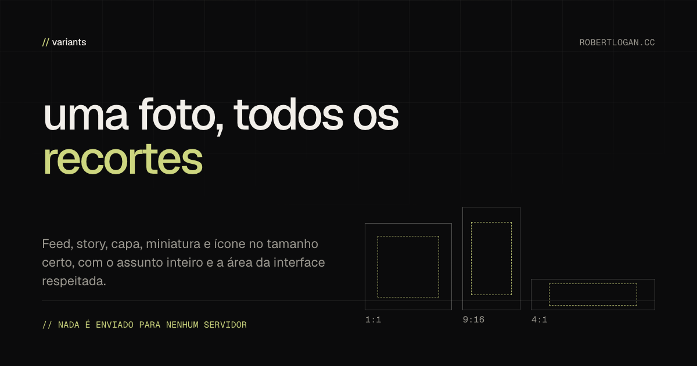

# variants

Uma imagem mestre entra, todos os recortes saem. Uma ferramenta de navegador que transforma uma foto só nos tamanhos que a internet pede, com o assunto inteiro no quadro e a área coberta pela interface de cada plataforma respeitada.

Nada é enviado para servidor. Não tem conta, não tem back-end, não tem upload.



## O problema

Todo projeto precisa da mesma foto em uma dúzia de formas: 1,91:1 para prévia de link, 1:1 e 4:5 para feed, 9:16 para story e short, 16:9 para vídeo, 4:1 para capa de perfil, mais o pacote de ícone. Fazer isso na mão é meia hora do mesmo arrastar e ampliar, e fazer no corte central decapita quem está na foto.

Pior: algumas dessas formas são cobertas pela própria plataforma. O story põe cabeçalho em cima e legenda embaixo. O TikTok põe botão na direita. O YouTube carimba o tempo no canto inferior direito. Um recorte pode estar tecnicamente certo e ainda esconder o rosto atrás de um botão.

## Como funciona

1. A imagem é reduzida para 96 pixels de largura e vira um **mapa de interesse**: força de borda, tom de pele, saturação, com uma atração fraca pelo centro. Nenhum modelo é baixado, nenhuma chamada de rede é feita.
2. Para cada preset, a maior janela com a proporção certa é posicionada pontuando todas as posições possíveis. Interesse dentro da faixa segura conta inteiro, interesse na faixa que a interface cobre conta um quinto, e interesse logo além da borda da janela é penalizado, para não cortar o assunto ao meio.
3. O resultado é desenhado em canvas, em duas passadas, para evitar o serrilhado que uma redução grande de uma vez produz.

O mapa é heurística, não detecção de rosto. Funciona porque um rosto tem borda, tom de pele e saturação ao mesmo tempo, combinação rara em fundo.

## Presets

| preset | medida | zona segura | para quê |
|---|---|---|---|
| Open Graph | 1200 × 630 | nenhuma | Facebook, LinkedIn, WhatsApp, X |
| X (timeline) | 1600 × 900 | nenhuma | 16:9, cortado para 2:1 em tela larga |
| Instagram feed | 1080 × 1080 | nenhuma | post quadrado |
| Instagram retrato | 1080 × 1350 | nenhuma | 4:5 ocupa mais feed |
| Story e Reels | 1080 × 1920 | 13% topo, 18% base | cabeçalho, legenda, botões |
| TikTok | 1080 × 1920 | 7% topo, 25% base, 12% direita | legenda e coluna de botões |
| YouTube | 1280 × 720 | 12% base, 22% direita | carimbo de tempo |
| Capa de perfil | 1584 × 396 | 28% base, 16% esquerda | a foto de perfil cobre o canto |
| Pinterest | 1000 × 1500 | nenhuma | 2:3, aparece inteiro |
| Cabeçalho de e-mail | 600 × 200 | nenhuma | 3:1, 600 px sobrevive na maioria dos clientes |
| Perfil de empresa | 1200 × 900 | nenhuma | 4:3, usado em cartão de local |
| Ícone | 16, 32, 48, 180, 192, 512 | 17% em volta | ícone adaptativo do Android recorta em círculo |

Medidas conferidas em outubro de 2026. Plataforma muda tamanho sem avisar, e cada número mora em `src/presets.ts`, em uma tabela só, então a mudança é uma linha.

## O que não faz

- Não detecta rosto. Acha a região de maior interesse visual, que quase sempre é o assunto e de vez em quando é um logo claro.
- Não cria espaço que não existe. Um close 3:4 recortado em 9:16 não tem folga vertical, então o enquadramento é o que a fonte permite.
- Não escreve texto, template ou título. O recorte é o produto inteiro.
- O pacote de ícone é arte quadrada. Logo com texto não sobrevive a 16 px.

## Exportação

`Baixar tudo` gera um zip com:

- cada tamanho selecionado, com a medida no nome (`story-1080x1920.jpg`), em JPEG na qualidade escolhida, menos o pacote de ícone, que é PNG;
- `favicon.ico` com 16, 32 e 48 dentro;
- `manifesto.json` com o nome da fonte, a hora, o retângulo do recorte e a zona segura de cada arquivo;
- `indice.html`, uma folha de contato que abre offline e mostra todos os recortes lado a lado.

## Comandos

```
npm install
npm run build     # compila src para dist
npm test          # 23 testes de recorte, mapa de interesse, zip e ico
npm start         # serve public e dist em http://localhost:4333
npm run site      # monta site/, pronto para qualquer host estático
```

## Estrutura

```
src/tipos.ts        tipos compartilhados
src/presets.ts      cada medida de plataforma e a zona segura
src/saliencia.ts    mapa de interesse e a tabela integral usada para pontuar
src/recorte.ts      posicionamento da janela, o núcleo da ferramenta
src/zip.ts          escritor de zip, método guardar, CRC32 próprio
src/ico.ts          escritor de ico com PNG dentro
src/i18n.ts         textos em português e inglês
src/app.ts          interface, desenho em canvas, arrastar para reposicionar, exportação
src/test/           23 testes, sem precisar de DOM
public/             casca da página, estilo, fontes, ícone
scripts/            servidor de desenvolvimento e montagem estática
```

## Fontes

A interface usa Geist e Geist Mono, servidas de `public/fontes/`, sob a SIL Open Font License 1.1. O texto da licença vai junto das fontes.

## Autor

[robertlogan.cc](https://robertlogan.cc)

## Licença

MIT.
